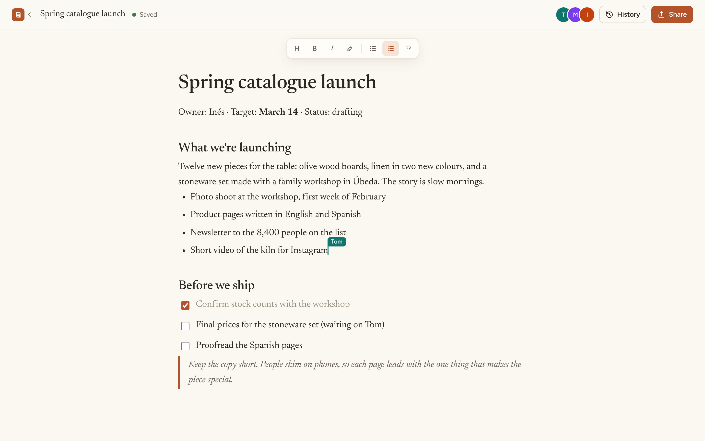
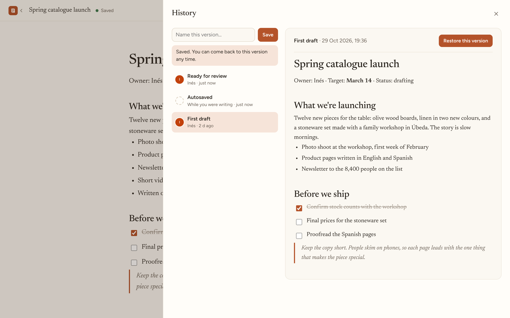
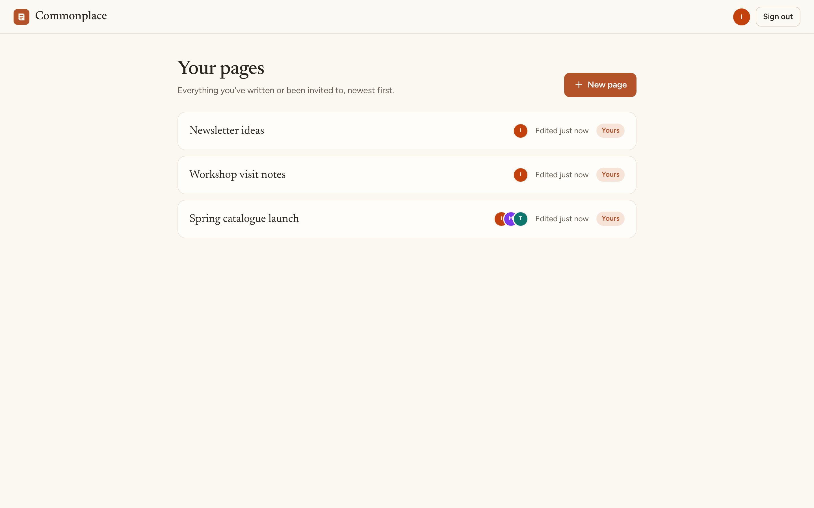
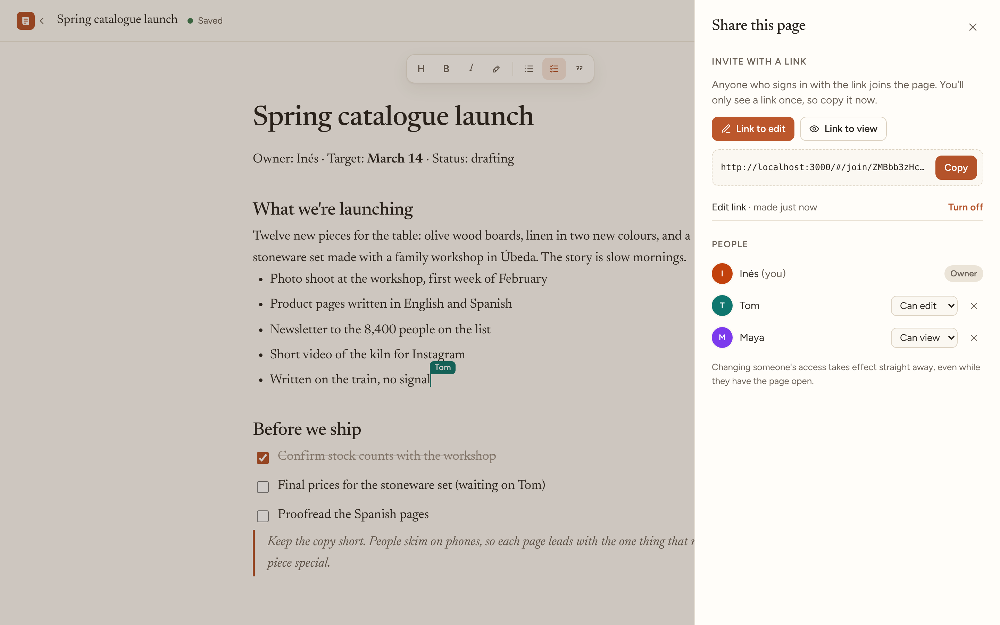
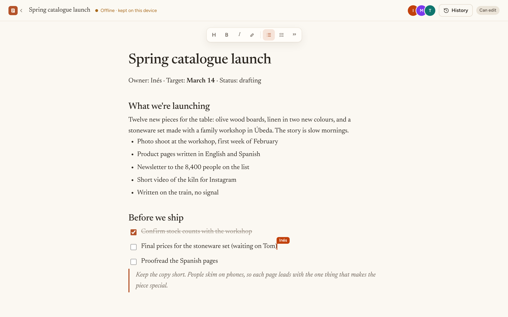
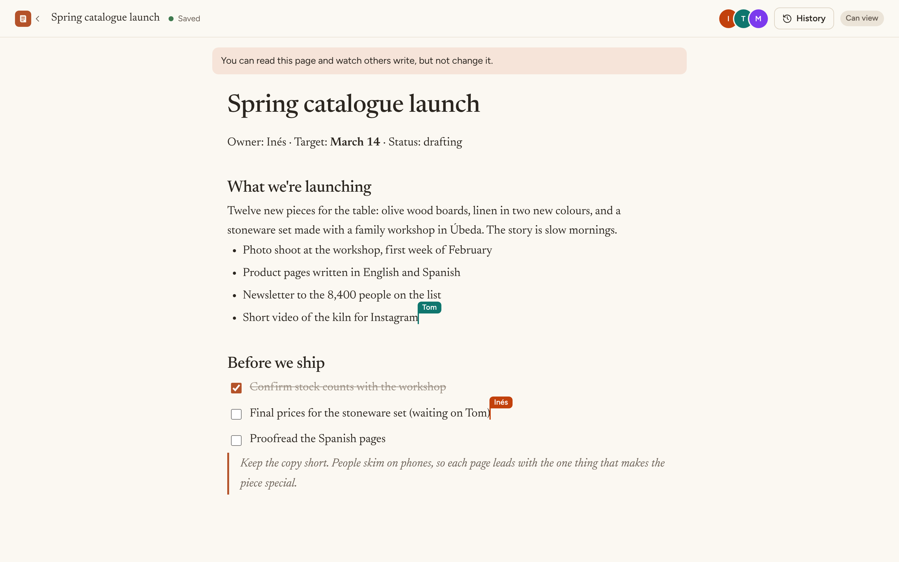
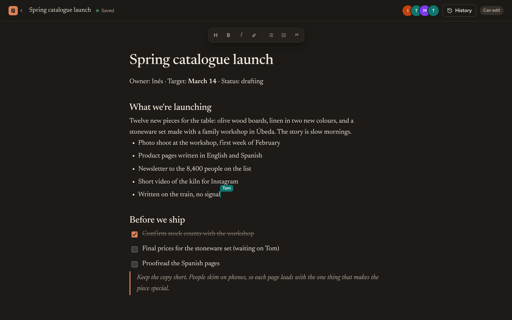
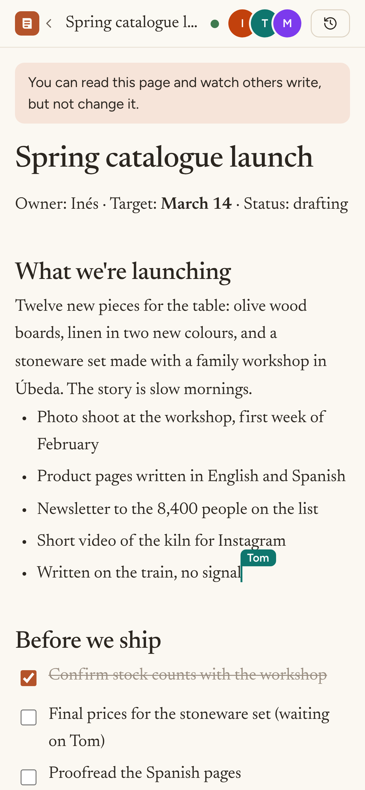

# Commonplace

**A shared notebook for small teams. Several people write on the same page at once, and it keeps working offline.**

Inés runs a small ceramics studio. She, Tom and Maya plan launches, workshop visits and newsletters
together in Commonplace. Each of them sees the others' cursors as they type. Tom can keep writing
on the train with no signal and his lines merge in cleanly when he's back. Maya can read pages but
not change them, and if Inés removes someone, their open tab stops receiving the page that same second.



## What it shows

| | |
|---|---|
| **Conflict-free editing** | Every page is a [Yjs](https://yjs.dev) CRDT. Edits from any number of people merge the same way on every machine, with no locking and no "someone else changed this" dialogs. |
| **Offline first** | Each browser keeps a copy of the page in IndexedDB. Edits made offline are saved locally and sent when the connection comes back. Local copies are kept per user and deleted on sign-out, so a shared computer doesn't leak pages. |
| **Presence** | Live cursors and selections with each person's name and colour, plus a row of avatars for who's on the page. |
| **Roles enforced on the server** | Owner, editor or viewer. A viewer's WebSocket connection is read-only on the server, so a modified client still can't change the page. People without access get a 404, so page ids can't be probed. |
| **Instant revocation** | Removing someone, or changing their role, closes their live connections immediately. |
| **Share links** | Invite links with a role. Only a hash of the token is stored, the link is shown once, and it can be turned off at any time. Joining never downgrades someone who already has more access. |
| **Version history** | An automatic snapshot at most every 10 minutes while a page changes, plus named versions. Restoring saves the current state first ("Before restoring …") and then pushes the old version to every open editor. |



## Architecture

```
  Browser                                           Server (one Node process)
  ┌────────────────────────────┐                   ┌───────────────────────────────────────┐
  │ React + TipTap editor       │  HTTPS /api ────▶ │ Fastify: accounts, pages, sharing,    │
  │ Y.Doc ◀──▶ IndexedDB copy   │                   │ versions (cookie sessions)            │
  │   ▲                         │  WSS /collab ───▶ │ Hocuspocus: Yjs sync + awareness      │
  │   └─ Hocuspocus provider ───┼──────────────────▶│   onAuthenticate → role → read-only?  │
  └────────────────────────────┘                   │   store → Postgres (debounced)        │
                                                    └──────────────────┬────────────────────┘
                                                                       ▼
                                                        PostgreSQL: users, sessions, documents
                                                        (Yjs state), members, links, versions
```

- The page is stored as the binary Yjs state in `documents.state`. The server reads the first heading
  of every saved state and mirrors it into `documents.title`, so the page list never has to decode
  documents.
- A page is always `heading block*`: the first line is the title. New pages are created on the server
  with an empty title already in place, so two people opening a brand new page can't both insert one.
- The client only mounts the editor once the shared document has content, or the server has said
  the page is genuinely empty and sync has finished. Mounting earlier lets the editor create its own
  empty structure, which then merges with the real one.
- Restoring a version replaces the shared fragment through a direct server-side connection, which
  goes out to every open editor as a normal Yjs update.

**Stack:** TypeScript everywhere. Node 22, Fastify 5, Hocuspocus 4, Yjs, PostgreSQL 16. React 19,
TipTap 3, Vite. Vitest with Testcontainers. Docker.

## Run it

You need Docker.

```bash
cp .env.example .env        # set POSTGRES_PASSWORD to a long random value, e.g. openssl rand -hex 24
docker compose up --build
```

Open http://localhost:3000 and create an account. To get the demo studio with three people and a few
pages, set `SEED_DEMO=true` and a `DEMO_PASSWORD` of at least 10 characters in `.env`, then sign in as
`ines@example.com`, `tom@example.com` or `maya@example.com`. Open two browsers side by side to see
live editing.

### Develop

```bash
# a local Postgres, then:
cd server && npm ci && DATABASE_URL=postgres://… APP_ORIGIN=http://localhost:5173 npm run dev
cd web && npm ci && npm run dev     # Vite proxies /api and /collab to :3000
```

| Variable | |
|---|---|
| `DATABASE_URL` | Postgres connection string (required) |
| `APP_ORIGIN` | The public origin, e.g. `https://notes.example.com` (required). Used for the Origin check and for `Secure` cookies when it's https. |
| `TRUSTED_PROXIES` | Addresses of reverse proxies whose `X-Forwarded-For` should be trusted, e.g. `10.0.0.0/8`. Unset means none. |
| `SEED_DEMO`, `DEMO_PASSWORD` | Demo data, local only. |

## Tests

```bash
cd server && npm test       # needs Docker: starts a real Postgres with Testcontainers
```

19 tests drive the real server with real WebSocket clients:

- **Collaboration:** two people typing at once converge; an offline client's edits merge on reconnect;
  pages survive a restart and keep their title; connections without a session, from non-members or
  from a foreign origin are refused; a viewer's edits never reach anyone; a removed person is
  disconnected immediately.
- **API:** cookie flags, cross-site requests rejected, login rate limiting, hidden pages return 404,
  share links (join, no downgrade, revoke), owner-only actions, saving and restoring versions,
  viewers can't restore.

CI runs the tests, type checks, a production `npm audit` for both packages, the web build and the
Docker image build.

## Security notes

- Passwords are hashed with scrypt. Login takes the same time whether or not the email exists.
- Sessions are random 256-bit tokens in an `HttpOnly`, `SameSite=Lax` cookie (`Secure` over https).
  Only their SHA-256 is stored, so a database leak doesn't hand out live sessions.
- Every state-changing API request and every WebSocket upgrade must come from `APP_ORIGIN`.
- Rate limits on sign-up, login and joining by link.
- A strict Content Security Policy and the usual security headers. Static files are served from
  memory, so there's no path on disk to traverse.
- WebSocket messages are capped at 2 MB.
- The container runs as a non-root user, and compose only publishes the app on 127.0.0.1.

## Screenshots

| | |
|---|---|
|  |  |
|  |  |
|  |  |
